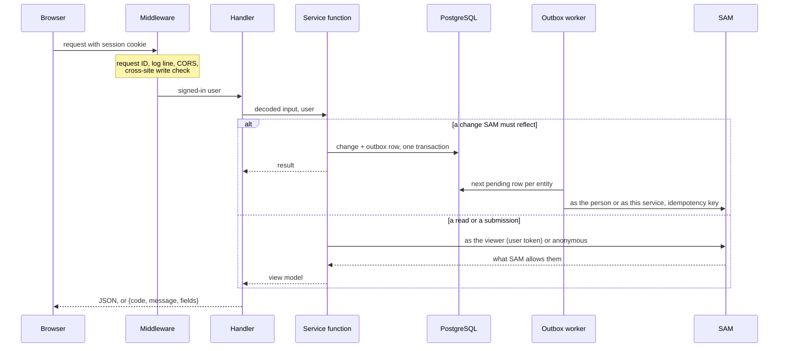

# DaGrouper School backend: design overview

This is the design the service is built to. The pages under `docs/design/` describe the intended system. Pages describing what is built sit one level up and are listed in the [documentation index](../README.md).

| Design document | Covers |
|---|---|
| This page | The product, its users, goals, requirements, the boundary with SAM, the architecture and open questions |
| [SAM integration](sam-integration.md) | The outbox and reconciler, who acts in SAM, user tokens and keys, idempotency, participant IDs, SAM's errors |
| [Accounts and sign-in](accounts-and-sign-in.md) | Google sign-in, phone codes, sessions, profiles, environments and the demo conveniences |
| [Classrooms and permissions](classrooms-and-permissions.md) | Roles, the permission grid, role groups and grants in SAM, invitations, consent, host applications |
| [Labs and readings](labs-and-readings.md) | Labs, devices, reading upload, manual observations, offline sync |
| [Dashboards and public site](dashboards-and-public-site.md) | Current conditions, alert levels, the raw table, member views, sharing and release, public pages, CSV, photos |
| [Registry and content](registry-and-content.md) | SAM's registry with this service's overlay, registry admin, and platform configuration |
| [Security and privacy](security-and-privacy.md) | The threat model and the data-protection points |

SAM's own design is in SAM's design (`docs/design/` in the sam repository). These pages refer to SAM by concept: spaces, principals, groups, grants with rules and obligations, attribute assertions, the registry, observations and publication.

## Context

DaGrouper School is a citizen-science programme. Schools and community groups host **Global Classrooms**. Each classroom runs one or more **labs**: places with sensors (weather stations, water and soil probes) and people who take manual observations (rain gauges, species sightings and counts). Members record data, review it, and release it to a public site where anyone can follow each classroom's station.

The front end (`frontend/`) is complete and runs on mock data in the browser. It is the product specification:

- `frontend/src/lib/services/types.ts`: the service interfaces and what each call does;
- `frontend/src/lib/services/http/routes.ts`: the HTTP contract, from which `openapi.yaml` is generated;
- `frontend/src/lib/domain/`: the data types and the shared rules (permissions, alerts, consent, hosting, validation).

This service replaces the mock. It is the only thing the front end talks to, and it is the first tenant of **SAM**, a separate, tenant-neutral service that stores observations and enforces who may read and write them.

## Users and roles

| Who | Signs in | What they do |
|---|---|---|
| Visitor | No | Reads the public site: released data, classroom profiles, contributors who asked for credit |
| Participant | Google or phone code | Joins classrooms by invitation, records readings and observations, may take credit and show a public profile |
| Minor | As a participant | A participant under 18. Records only once a guardian has consented. Never named in public; positions rounded |
| Guardian | No | Gives or withdraws consent for a minor, from a link or on a paper sheet |
| Community scientist | Participant | The default classroom role: reads the classroom's data, including unreleased data, and records |
| Researcher | Participant | Reads only |
| Facilitator | Participant | Runs sessions: records, sets device alert levels, records paper consent; invites community scientists, manages devices and releases data when the head allows it |
| Institution head | Participant | Owns the classroom: its details, members, sharing settings, data terms, release, photo and sensor-type alert levels |
| Platform admin | Participant with the admin flag | Runs the programme: sets up classrooms and labs, decides host applications, edits the registry, registers devices, manages members. Manages, but reads no classroom data unless invited as a member |
| Operator | Shell access | Runs the deployment: configuration, held SAM changes, signing keys. Not a product role |

The full permission grid is in [Classrooms and permissions](classrooms-and-permissions.md#the-permission-grid).

## Goals

- Serve every call in `routes.ts`, so the front end runs on this service with `VITE_DATA_SOURCE=http` and the mock stays for demos only.
- SAM enforces every data permission. This service never grants a person in SAM what the grid refuses them, and never uses its own authority where a person's is due.
- Protect minors: consent before any submission, no public name, rounded positions.
- No request waits on SAM to write. SAM converges on this service's state after an outage, in order.

## Non-goals

- Storing observations. SAM is their system of record; this service keeps no copy.
- Anything a second SAM tenant would use unchanged. That belongs in SAM.
- Real device pairing in the browser with gateway signing. The front end's pairing stays simulated.
- Push notifications for alerts. Alert levels are evaluated when read.
- Generating Go types from `openapi.yaml`. Go types are written by hand and held to the contract by tests.

## Requirements

### Functional

| Area | Requirement | Design |
|---|---|---|
| Accounts | Sign in with Google or a phone code; onboarding collects profile, phone and address | [Accounts and sign-in](accounts-and-sign-in.md) |
| Classrooms | Create classrooms, invite members by email, change roles, remove members | [Classrooms and permissions](classrooms-and-permissions.md) |
| Consent | A minor's guardian consents by link or paper sheet; withdrawal stops submissions | [Classrooms and permissions](classrooms-and-permissions.md#guardian-consent) |
| Hosting | Anyone may apply to host a classroom; admins decide | [Classrooms and permissions](classrooms-and-permissions.md#host-applications) |
| Labs and devices | Labs with site profiles; devices typed by the registry | [Labs and readings](labs-and-readings.md) |
| Data in | Device uploads, guided manual observations, offline batches retried safely | [Labs and readings](labs-and-readings.md) |
| Data out | Current conditions, alert levels, the raw table and CSV, station and parameter pages | [Dashboards and public site](dashboards-and-public-site.md) |
| Release | Heads (and facilitators when allowed) release data up to a date; automatic review; data terms | [Dashboards and public site](dashboards-and-public-site.md#sharing-and-release) |
| Public site | Home, station, parameter, classroom profile and contributor pages for visitors | [Dashboards and public site](dashboards-and-public-site.md#public-pages) |
| Registry | Parameters, domains, device types and templates; admins edit presentation and add their own entries | [Registry and content](registry-and-content.md) |

### Privacy for minors

- A minor submits nothing until their guardian has consented. This service checks its own record before relaying, and SAM refuses a minor's submission without consent itself, so the submit grants carry no consent rule.
- Whoever reads a classroom may export it, through this service only: each reading group holds `export:create` limited by `export_to`. Heads and facilitators record consent through grants of their own, limited to the `consent` attribute.
- A withdrawal takes effect here at once, and in SAM as soon as the outbox delivers it.
- A minor is never named on public pages, never listed as a contributor, and cannot turn on a public profile.
- A minor's GPS position is rounded before it is sent to SAM. Public reads generalise every position further.
- Guardians' names and contacts are seen only by the classroom's head and facilitators.
- Real data from minors does not enter production until SAM's consent withdrawal, deletion and retention are in place and the data-protection review is done ([Security and privacy](security-and-privacy.md#data-protection)).

### Non-functional

| Quality | Requirement |
|---|---|
| Consistency | Every change SAM must reflect is delivered in order per entity, at least once, and applied once |
| Availability | Sign-in, profile and classroom changes work while SAM is down; reads and submissions that need SAM fail with a clear message |
| Security | No secret is stored in plain text; no development convenience runs outside development and test |
| Scale | The pilot: tens of stations, one reading a minute each. Pages read SAM's aggregates, latest values and summaries, each answered from its hourly rollups |
| Operability | Anything retrying cannot fix is held for an operator and listed by a command |
| Contract | Every response matches `openapi.yaml`, which is generated from the front end, or the backend's addendum for what the front end has not adopted yet |

## The boundary with SAM

A capability goes into SAM only if it can be described without DaGrouper words (classroom, lab, facilitator, release cutoff, reference rain gauge) and a second tenant would use it unchanged. Everything else lives here and is composed from SAM's primitives.

| DaGrouper concept | In SAM | Kept here |
|---|---|---|
| The programme | The tenant: root space, service principal, trusted issuer, tenant grant | Nothing |
| Person | A `user` principal whose subject is the participant ID | Name, email, phone, address, sessions, Google identity |
| Minor, consent | Attribute assertions `minor` and `consent` | Guardian identity, link tokens, paper-sheet records |
| Classroom | A space under the tenant root | Name, code, institution, profile, stage, region, sharing settings, terms text |
| Classroom role | Membership of one of the classroom's four role groups | Members and their roles |
| Platform admin | Membership of the tenant's admins group, which manages and never reads | The admin flag |
| Lab | A child space with a site | Name, place, site questionnaire, parameter notes |
| Device | A device principal in the lab's space, typed by the registry | Display name, hardware identifier |
| Reading, observation | Observations, validated and flagged by SAM | Who recorded each relayed record, who asked for credit, which form it came through |
| "Show public", automatic review | Anonymous grants on published records, one with an embargo | The settings |
| Release through a date | A publish of the space up to a time, as the person releasing | The cutoff, cached |
| Data terms | The space's data policy | Display copy |
| Registry | SAM's registry: core entries plus this tenant's own under `dgs:` | Presentation overlay, change log, alert defaults |
| Alerts, current conditions, completeness | Nothing: computed from SAM's reads | Alert rules, tile and card selection |
| Invitations, host applications, places, one-time codes, platform configuration, photos | Nothing | All of it |

## Architecture

### Drivers

| Requirement | Architectural consequence |
|---|---|
| The front end talks to one service, over the contract generated from its routes | This service implements `openapi.yaml` exactly, with the operations and shapes its addendum lists, and tests hold every response to them ([The contract](#the-contract)) |
| SAM is the record for observations and decides who may read and write them | This service keeps no copy of readings. It reads them from SAM as the viewer, so SAM's answer is the user's answer |
| People, classrooms and memberships live here, and SAM must reflect them | Every change SAM must know about is queued in the same transaction as the change, and delivered and reconciled in the background ([SAM integration](sam-integration.md)) |
| SAM's checks must see the person who acts | Changes a person makes reach SAM as that person, with a short-lived token this service signs; policy changes go as this service |
| Sign-in and pages keep working when SAM is slow or down | No request waits on SAM to write. Reads from SAM degrade to what can be shown without it |
| Minors' data is protected | Consent and minor status are checked here before anything is relayed, as well as by SAM's rules |

### System context

```
                       cookie                       service key + user token
Browser (SvelteKit) ───────────► dgs (Go) ─────────────────────────────────────► SAM
                                   │  ▲                                            ▲
                                   ▼  │                                            │
                             PostgreSQL (own)               Sensors and adapters ──┘
                                                              (signed readings)
           Google sign-in, SMS and email providers, address lookup ◄── dgs
```

This service has its own database and SAM has its own; neither reads the other's. SAM verifies the user tokens this service signs against a key set this service publishes.

### Structure

```
 transport      HTTP: CORS, the cross-site check, request IDs, sessions, decoding, errors
     │
 modules        one per area of the product: accounts, sign-in and profiles, classrooms,
     │          consent, hosting, labs and readings, registry, content, public site
     │
 shared         SAM access (connection, tokens, outbox, reconciler); delivery (SMS, email);
     │          pure computations behind dashboards and public pages
     │
 storage        pool, migrations, transactions
```

- **Transport** is shared middleware and helpers. It knows HTTP, the session cookie and the error format, and nothing about classrooms or readings.
- **Modules** hold the product's rules. Each serves one area of the API and owns its tables.
- **SAM access** is one place that talks to SAM: the client, token signing and the outbox. It never depends on a module; each module tells it how its own entities reach SAM.
- **Pure computations** (rain totals, trends, completeness, the seven-day strip, alert layering) have no database or network, so they are unit-tested on their own and give the same answers as the front end's mock.

Dependencies point down only. One constructor builds every module from one set of dependencies; the command and the integration tests both use it, so tests run what production runs.

### Modules

Every module has the same shape, so a reader who knows one knows them all:

- Its dependencies are passed in when it is built and never set later: the database, sessions, the SAM connection if it reads SAM, and a clock if anything in it expires.
- It registers its own routes on the shared router.
- A handler decodes the request, calls one service function and encodes the answer. Only HTTP concerns stay in the handler.
- A service function holds the rules and the transaction. It takes the user and plain values and returns a typed result, so a test or an operator command can call it without a request.
- Its tables are reached only through its own store functions, which work on the pool or inside a transaction.
- If SAM must reflect its entities, the module defines how: what it queues, how each change is applied in SAM, and how its state is compared with SAM's.

### Data ownership

Each table belongs to one module, and no other module queries it; a test checks this, with each exception listed and its reason given.

| Area | Holds |
|---|---|
| Accounts and sign-in | Users and their profiles, their identities, sessions, phone challenges and their limits |
| Classrooms | Classrooms, stages and regions, memberships, invitations, consent records and consent texts, and what each is in SAM |
| Hosting | Host questions and applications |
| Labs and readings | Labs, devices, relayed and synced records, alert levels, and what each is in SAM |
| Registry and content | The registry overlay and its change log, alert defaults, settings and the configuration change log |
| Media | Stored photos |
| SAM access | The outbox |
| Demo data | What the demo tool has loaded (development only) |

Reading a member's name alongside a list of classroom members is the one expected exception: joining through the accounts module's functions would turn one query into many.

### Request path



Writes to SAM never happen in the request: the change commits here, and the outbox delivers it. Reads from SAM and relayed submissions do happen in the request, because SAM's answer is the user's answer.

### The contract

`openapi.yaml` is generated from the front end's routes and is never edited here. Some of what this service serves comes before the front end has it: the platform configuration admin, consent text versions. Those are kept in `contract-addendum.yaml`, owned by this service:

- **What it holds.** Operations the generated contract lacks, and operations whose request or response shape changes, each with the front-end change it waits for. An entry for a changed operation replaces that operation's shapes; everything else comes from `openapi.yaml`.
- **Checked the same way.** The integration tests load both and hold every response to them, so an addendum operation is as tested as any other.
- **Shrinks to nothing.** When the front end adopts an entry, the regenerated contract has it and the entry is removed. A test fails on an entry the generated contract already matches, so none outlives its need.
- **Listed for the front end.** Each entry names what the front end must add, so the two meet at one contract.

### Errors

Every error the front end sees is `{code, message, fields}`. `code` is one of the front end's `ServiceErrorCode` values, `message` is shown to the user as it is, and `fields` holds a message per input. Anything unexpected is logged with the request ID and answered as `internal`, with a generic message, so no internal detail reaches the user. SAM's refusals are translated ([SAM integration](sam-integration.md#translating-sams-errors)).

### Background work

| Task | Effect |
|---|---|
| Outbox worker | Sends queued changes to SAM in order per entity, with retries and backoff; holds a change it cannot send for an operator |
| Reconciler | Compares users and each classroom's public grants with what SAM holds, and queues a correction where they differ |

Each runs on one instance at a time, under a database lock.

### Deployment and scaling

Instances are stateless apart from the database and run behind the front end's origin. Sessions are rows, so any instance serves any request. Operators use the same binary for migrations, held outbox changes and site configuration. Demo data is loaded by a separate tool that is never part of the service ([Accounts and sign-in](accounts-and-sign-in.md#demo-data)).

## Alternatives considered

| Alternative | Why not |
|---|---|
| Writing to SAM inside each request | Sign-in and every change would fail while SAM is down, and a crash between the two writes would leave the databases apart with nothing to notice |
| Keeping a copy of readings here | Two records of the same data, and this service would have to repeat SAM's read rules for every viewer |
| Sending every change to SAM as this service | SAM's checks on the actor would protect nothing, and its audit would name the service instead of the person |
| The front end calling SAM directly | SAM holds no personal data and knows nothing of classrooms; every page needs both in one answer |
| Waiting for the front end's contract before serving anything new | Backend work that admins need, such as platform configuration, would wait on pages that are built later. The addendum keeps it tested and visible until the front end adopts it |
| A service per area | One database and one small team. Modules that own their tables keep the boundaries without the cost of running several services |

## Risks

| Risk | Mitigation |
|---|---|
| SAM reflects a change only once it is delivered, so it may be more permissive meanwhile (consent still given after a withdrawal, a removed member still in a group, a public grant not yet revoked) | Every call for a person or a visitor checks this service's own record first: consent, membership and role, and the sharing settings ([SAM integration](sam-integration.md#the-outbox)) |
| The contract drifts from the front end | The contract is generated from the front end's routes and checked in CI; every integration response is validated against it |
| The addendum and the front end diverge | Each entry names the front-end change it waits for, and a test fails on an entry the generated contract already matches |
| A module reaches into another's tables | The ownership test fails, unless the exception is listed with its reason |
| A change is held in the outbox and nobody notices | Held changes are logged as warnings and listed for operators ([SAM integration](sam-integration.md)) |

## Testing approach

- **Unit tests** for pure logic, in the package that holds it, written here rather than translated from the front end's specs. They are never replaced by an end-to-end test.
- **Integration tests** (`internal/apitest`) build SAM from its source, start it on a fresh database, onboard this service as its tenant, and drive this service over HTTP. Every response is validated against `openapi.yaml` and the addendum, and a route-coverage report lists every operation without a handler; once every operation is served, it fails on any that is not.
- **Parity:** the permission grid is checked cell by cell against SAM's answer.
- **End to end:** the front end's own HTTP client runs against the compose stack, and a generated Postman collection walks every operation.
- **Every fix ships with a test that fails without it.**

## Open questions

Contract questions with the front end:

- **Who creates classrooms.** The service comment says heads and platform admins; the mock lets only platform admins. This design follows the mock.
- **What a non-member platform admin sees.** The mock shows them unreleased readings on the lab page and in a device's readings, and its grid lets them record. Here they manage but neither read nor record without membership.
- **Link tokens.** The mock returns invitation, guardian and host-application tokens to the client; the comments say they are only sent. Here they are returned in demo mode only.
- **A removed device's readings:** whether they stay in exports and on public pages.
- **Future-dated observations:** one rule across upload, submit and batch.
- **The `credit` flag,** which the UI always sends as false.

Design questions:

- **How sensors reach SAM.** The current agreement is that they send signed readings to SAM directly. The relay cannot alter a signed reading, so either path fits this design.
- **Guardian links** have no expiry; a new request replaces the link. Whether they should expire.
- **Personal data retention and deletion** periods, which depend on SAM's retention work ([Security and privacy](security-and-privacy.md#open-questions)).
